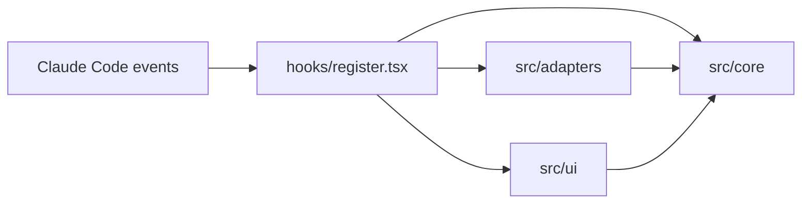
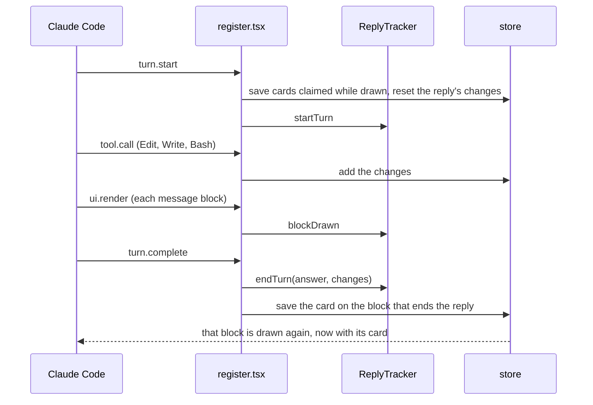

# Architecture

files-changed is small, but it is split so that each part can be read, tested and changed on its own.

**In one paragraph:** while Claude writes a reply, the mod collects every file change: from the results of the Edit and Write tools, and from Bash commands by comparing git snapshots taken before and after them. When the reply ends, those changes are given to the message block that ends the reply, and that block is drawn with a card under it.

## Layers

The code follows *functional core, imperative shell*: the rules live in pure functions with no access to Claude Code, and a thin outer layer connects them to Claude Code's events, state and processes.



| Folder | Holds | Imports from |
|---|---|---|
| `src/core/` | Pure logic: how changes add up, how diffs are read, how paths are shown, which block gets the card | `types/` only |
| `src/adapters/` | Translation between Claude Code (tool results, git, session state) and the core | `core`, `types`, the `claude-code` API |
| `src/ui/` | What the card looks like and the words it uses | `core`, `types`, the `claude-code` API types |
| `hooks/register.tsx` | Which event calls what, in the order a reply goes through them | everything above |
| `types/` | The data shapes and the contract of the saved state | nothing |

Dependencies point inward: `core` never imports from the layers around it, so it can be tested and reused without Claude Code.

## Files

| File | Responsibility |
|---|---|
| `hooks/register.tsx` | Wires the five events the mod listens to |
| `src/core/changes.ts` | Adds changes to a list (one row per file) and totals them |
| `src/core/diff.ts` | Turns a structured patch or a git diff into changes |
| `src/core/paths.ts` | Splits a path into the name and folder the card shows |
| `src/core/reply-tracker.ts` | Decides which message block of a reply gets its card |
| `src/adapters/edit-write.ts` | Reads an Edit or Write result |
| `src/adapters/git.ts` | Takes git snapshots and diffs them; every git command the mod runs is here |
| `src/adapters/store.ts` | Everything the mod saves in the session's state |
| `src/ui/card.tsx` | Draws the card |
| `src/ui/labels.ts` | Every text the card shows |
| `types/index.d.ts` | `FileChange`, `CardsByBlock` and the state contract |

## Lifecycle of a reply



Subagent turns (`e.agentId` set) are not replies: what their tools change counts toward the reply that spawned them.

## Design decisions

- **Which block gets the card.** The plugin API does not mark the block that ends a reply. The card goes on the block whose text ends the reply's answer (`turn.complete` gives the answer), among the blocks first drawn since the reply started, so a block from an earlier reply with the same text never takes it.
- **Cards claimed while drawing wait in memory.** VS Code can draw a reply's last block after the reply ends. That block claims the card while it is drawn, but Claude Code refuses state writes during drawing, so `ReplyTracker` holds the card until the next reply starts and `register.tsx` saves it.
- **All state in one file.** Claude Code's scanner requires each state value to be read and written in the file that declares it, so `store.ts` is the only file that touches state.
- **Functions that receive `$` are `function` declarations.** The scanner follows `$` across an import only into a function declaration.
- **`git stash create` for Bash.** It records the working tree as a commit without touching the user's work, so the diff of two snapshots is exactly what one command changed, even when there were uncommitted changes before it. The cost is up to four git commands before and after each Bash call, inside a repository; one outside.
- **Hex colors.** VS Code does not draw Claude Code's theme color names (`diffAdded`).

## What the mod runs on your machine

Only these git commands, all in `src/adapters/git.ts`, and only around Bash calls in the foreground:

```
git -c core.quotepath=off rev-parse --show-toplevel
git -c core.quotepath=off stash create
git -c core.quotepath=off rev-parse HEAD
git -c core.quotepath=off ls-files --others --exclude-standard -z
git -c core.quotepath=off diff --no-renames --no-ext-diff --no-textconv <before> <after>
git -c core.quotepath=off diff --no-index --no-ext-diff --no-textconv -- /dev/null <new file>
```

All are read-only except `git stash create`, which writes an unreferenced commit to `.git/objects` (git's garbage collector removes it later) and, like `git status`, may refresh the index's cached file stats. `--no-ext-diff` and `--no-textconv` keep git from running diff programs a repository configures. Claude Code runs git with repository hooks off. The mod makes no network requests and writes no files of its own. `tests/adapters.test.ts` checks this exact list.

## Extending it

**A new source of changes** (for example the NotebookEdit tool):

1. Add an adapter in `src/adapters/` that turns the tool's result into `FileChange`s, using the helpers in `src/core/diff.ts`.
2. Add a `tool.call` hook in `hooks/register.tsx` that calls it and passes the changes to `addTurnChanges`.
3. Test the adapter in `tests/adapters.test.ts`, and the whole flow in `tests/plugin.test.tsx` if it needs Claude Code's events.

**Another language:** change the texts in `src/ui/labels.ts`.

**A change to what is saved:** change the shape in `types/index.d.ts` and its atom in `src/adapters/store.ts`. When the stored value's form changes, change the atom's `shape` tag too: a value saved under another tag is then read as the atom's initial value instead of being misread.

## Tests

| File | Covers |
|---|---|
| `tests/core.test.ts` | The pure logic, without Claude Code |
| `tests/adapters.test.ts` | Edit and Write results, and the exact git commands run |
| `tests/plugin.test.tsx` | The whole mod through Claude Code's test host, on every surface |
| `tests/fake-engine.ts` | What Claude Code answers beneath the mod during the tests |

```
claude plugin test .
```
